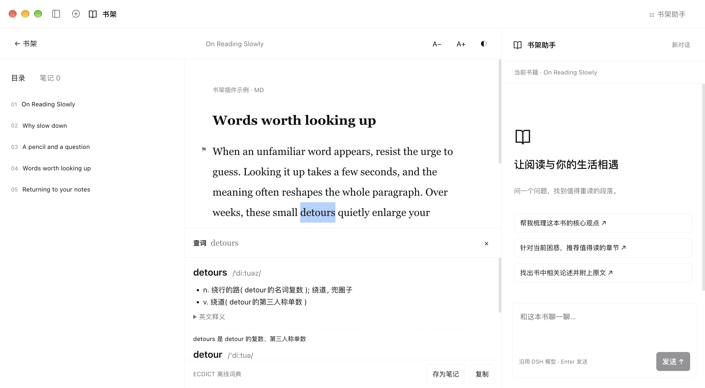
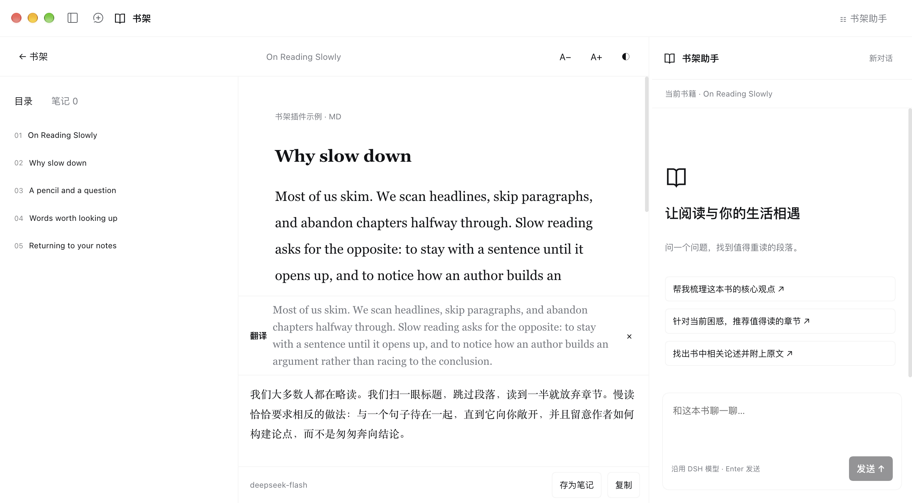

<p align="center">
  
</p>

<h1 align="center">DSH 书架</h1>

<p align="center">
  <b>把本地藏书装进 DeepSeek Harness：沉浸阅读、离线查词、一键翻译，书架助手的回答附带原文引用。</b>
</p>

<p align="center">
  <a href="#安装"><b>安装</b></a>
  &nbsp;·&nbsp;
  <a href="#功能一览"><b>功能一览</b></a>
  &nbsp;·&nbsp;
  <a href="#查词与翻译"><b>查词与翻译</b></a>
  &nbsp;·&nbsp;
  <a href="#配置"><b>配置</b></a>
</p>

<p align="center">
  
  
  <a href="https://github.com/matriiix67/dsh-book-plugin/stargazers"></a>
  <a href="./LICENSE"></a>
</p>

<p align="center">
  
</p>
<p align="center"><sub>左侧目录、中间正文与查词面板、右侧书架助手。双击单词即查，变形词同时给出原形。</sub></p>

## 这是什么

`dsh-book-plugin` 是 [DeepSeek Harness](https://github.com/deepseek-ai/deepseek-harness)（DSH）的社区插件，与 DeepSeek 无隶属关系。装上后，DSH 侧栏多出「书架」入口：导入 EPUB、Markdown 或 TXT 就能在 DSH 里读书、记笔记、查生词、翻译难句，再让书架助手基于你的藏书回答问题，每条回答都能点回原文。

书籍和笔记只保存在本机；查词使用离线词典，不联网。

## 功能一览

| 功能         | 你能做什么                                                                                            |
| ------------ | ----------------------------------------------------------------------------------------------------- |
| **书库**     | 导入单本或整个目录，相同内容自动去重；按书名、作者、标签筛选，管理阅读状态与书籍信息。                |
| **阅读**     | 按章节阅读，可调字号和纸张背景，自动回到上次读到的位置；目录宽度可拖动调整。                          |
| **查词**     | 双击单词即查，离线英汉词典（ECDICT，约 77 万词条）给出音标、释义、考试标签与词形变化。                |
| **翻译**     | 选中句子或段落一键翻译，由 DSH 当前模型结合上下文生成，译文流式显示。                                 |
| **笔记**     | 高亮、书签和阅读笔记，查词与译文也能存为笔记；可导出为 Markdown。                                     |
| **搜索**     | 在全部藏书中检索关键词，结果可跳回原文。                                                              |
| **书架助手** | 围绕全部藏书或单本书提问，回答附带可点击跳转的原文引用；DSH 助手也能通过 `bookshelf` 工具查书和查词。 |

## 安装

适用于 **DeepSeek Harness 0.2.1-rc.5** 及之后的 0.2 版本。

1. 在 DSH 中打开「插件 → 添加插件」，填入：

   ```
   github:matriiix67/dsh-book-plugin#v0.1.1
   ```

   `#` 后面是版本号，最新版本见 [Releases](https://github.com/matriiix67/dsh-book-plugin/releases)。

2. 安装完成后点击「立即启用」，侧栏出现「书架」入口即可使用。

**无法访问 GitHub**：从 [Releases](https://github.com/matriiix67/dsh-book-plugin/releases) 下载 `dsh-book-plugin-<版本号>.tgz`，在「添加插件」中填入该文件的绝对路径。

**从源码目录安装**：`git clone` 本仓库后，在「添加插件」中填入克隆目录的绝对路径。仓库已包含构建产物，无需另装依赖。

**更新**：在插件页卸载「书架」，再按上面的方式安装新版本，书库与笔记不受影响。从源码目录安装的，执行 `git pull` 后重启 DSH 即可。

## 使用

1. 点击「导入书籍」选择文件，或将文件拖到书架。也可以点击「目录」添加本地书籍目录，之后用「扫描书库」同步新增和更新的书。
2. 点击封面进入阅读。左侧切换章节，拖动目录右侧的分隔线可调整目录宽度；顶部调整字号与纸张背景。
3. 选中正文后，下方出现选段栏，完整显示所选文字，可查词、翻译、高亮、记笔记或带着原文向助手提问。段落旁的旗标用于添加书签。
4. 在「笔记」中查看、编辑或导出笔记；在搜索框输入关键词后点击「搜索正文」检索全库。
5. 右侧书架助手沿用 DSH 的模型与会话；点击「打开会话」可进入 DSH 的完整会话界面。

插件附带两本示例书：中文的 `examples/阅读与习惯.md` 适合体验笔记、搜索与书架助手，英文的 `examples/on-reading-slowly.md` 适合体验查词与翻译。将 `examples` 目录添加为书库即可快速上手。

## 查词与翻译

<p align="center">
  
</p>
<p align="center"><sub>选中段落点击「翻译」，原文与译文上下对照显示在正文下方，可复制或存为笔记。</sub></p>

- **查词**：双击单词直接查词，或选中单词、短语后点击「查词」。显示音标、中文释义、柯林斯星级、牛津 3000、考试标签、词形变化和英文释义；变形词会同时给出原形，例如 went → go、workflows → workflow。
- **翻译**：选中句子或段落后点击「翻译」，模型会参考所在段落理解语义。原文已是目标语言时译为英文。
- **结果面板**：显示在正文下方，不遮挡目录。面板高度固定，内容较多时在面板内滚动；拖动面板顶部的分隔线可调整高度。结果可复制或存为笔记，按 Esc 关闭。
- **安装词典**：第一次查词时按提示下载 [ECDICT](https://github.com/skywind3000/ECDICT)（MIT 协议，约 63 MB），也可以填写已下载的 `ecdict.csv` 绝对路径导入。
- **语境释义**：在插件配置中打开 `contextExplain` 后，查词面板会出现「结合上下文解释」，由模型说明该词在当前段落中的含义。默认关闭。

目录宽度和结果面板高度会被记住，下次打开沿用。

## 配置

在 DSH 的插件配置中修改：

| 配置项           | 默认值             | 说明                                                                   |
| ---------------- | ------------------ | ---------------------------------------------------------------------- |
| `storageDir`     | `~/.dsh/bookshelf` | 数据目录，可指定其他绝对路径。                                         |
| `targetLanguage` | 简体中文           | 翻译与语境释义的目标语言。                                             |
| `dictionaryUrl`  | ECDICT 官方地址    | 词典下载地址，网络不畅时可替换为镜像。                                 |
| `provider`       | 空                 | 与 `model` 同时填写时，翻译与释义改用指定模型；留空沿用 DSH 默认模型。 |
| `model`          | 空                 | 同上。                                                                 |
| `contextExplain` | 关闭               | 是否在查词面板中提供「结合上下文解释」。                               |

## 数据与隐私

- 所有数据保存在 `storageDir` 中：书籍副本与正文在 `books/`，书目、阅读进度和笔记在 `library.json`，词典在 `dictionary/`，翻译结果缓存在 `assist-cache.json`。备份时复制整个目录即可。
- 书籍原件只保存在本地。查词完全离线；提问、翻译和语境释义时，选中的文字及所在段落会发送给 DSH 当前使用的模型。
- 相同内容的翻译直接使用本地缓存，最多保留最近 600 条。
- 移出书架会保留原文件副本与笔记，重新导入相同内容后自动恢复关联。书籍内容更新后，旧笔记保留原摘录并提示版本差异。

## 限制

- 单本文件最大 64 MB，EPUB 解压后最大 160 MB；复杂排版会转换为便于阅读的正文。
- 单次翻译最多 4000 字。
- 暂不支持 PDF、DRM 书籍和有声书。

## 喜欢它？

如果书架让你在 DSH 里读得更顺手，欢迎点亮 ⭐，也欢迎在 [Issues](https://github.com/matriiix67/dsh-book-plugin/issues) 反馈问题和建议。

## 许可证

[MIT](./LICENSE)
